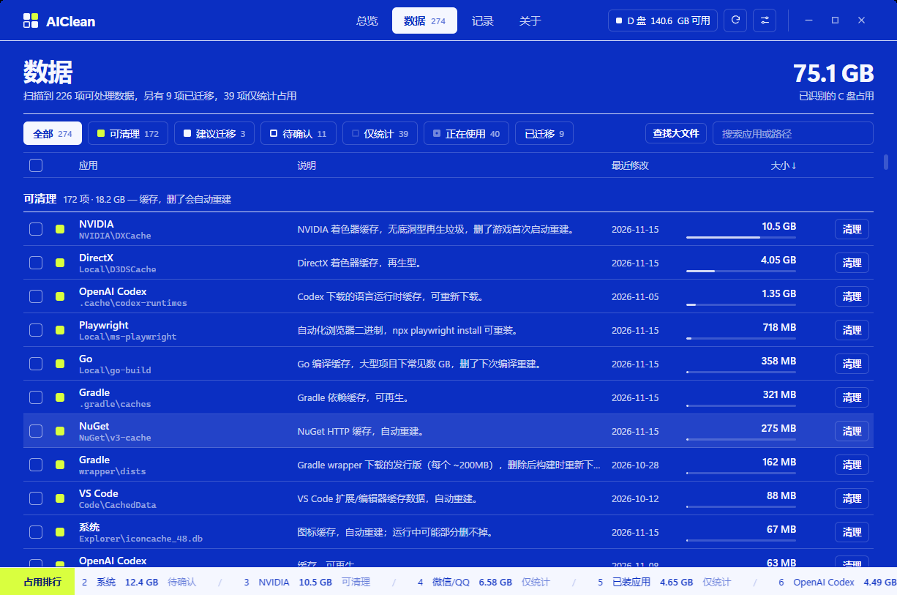

# AIClean · C 盘空间管家

C 盘又红了？这个小工具帮你搞清楚**空间到底被谁吃了**，然后安全地把它清出来。

单文件 exe，双击即用，不联网、不安装、不写注册表（除非你主动开计划任务）。

**[➡ 下载最新版](https://github.com/ZYY817/aiclean/releases/latest)**（Windows 10/11，64 位）


## 它能干什么

### 看明白 C 盘空间去哪了

打开就扫描，把整个 C 盘的占用画成一格一格的地图——每个格子约 1GB，鼠标移上去就知道是谁占的。再也不用对着"磁盘清理"那几个可怜的选项发呆。

### 分清哪些能删、哪些别动

扫出来的东西自动分好类，每一样都写清楚"这是什么、删了会怎样"：

- 🟦 **可清理** —— 各种缓存（着色器、浏览器、编译器、运行时……），删了软件自己会重建，放心清
- ⬛ **建议迁移** —— 你的数据（模型、聊天记录、项目依赖），不删，帮你搬到别的盘
- ⬜ **待确认** —— 看着像垃圾但需要你过一眼，比如老游戏存档、旧下载
- 🔘 **正在使用** —— 程序开着呢，关掉再处理
- ▫️ **仅统计** —— 告诉你它占了多少，但不碰它



### 一键清缓存

确认过的缓存，按住按钮就清。删不掉的（正在被占用的）不会硬删，进残留区，回头再处理。

### 把数据搬到别的盘，软件照常用

很多 C 盘爆满不是垃圾多，是软件把数据全堆在 C 盘（AI 模型、微信文件、游戏平台库……）。AIClean 把数据**原样搬到 D 盘 / E 盘**，原位置只留一个"快捷方式"式的链接——软件完全无感，C 盘空间实实在在省出来。想搬回来也随时能迁回。

### 定时自动清理（可选）

接上 Windows 计划任务，每天/每周自动清掉低风险缓存。**默认是关的**，想用自己在设置里开，开之前会再跟你确认一遍清的是什么。

### 不留尾巴的卸载

软件自己也能彻底移除：计划任务、开机自启、数据目录一条不留。走之前如果还有迁移的数据，会给你在桌面留一份清单，写清楚东西都在哪。

## 安全这块是认真的

- 不可逆操作（直接删除、清回收站、关休眠）都要**按住确认**，不是点一下就没
- 删之前先检查程序是不是还开着
- 迁移前整个备份一份，出问题能迁回；备份不要了也得验证原链接正常才能删
- 第一次启动会弹一份说明，哪些操作不能后悔写得明明白白
- 全程本地运行，不联网、不上传、不统计

## 适合谁

- C 盘三天两头爆满，每次手动清都清不干净的
- 装了一堆 AI 工具 / 开发环境，C 盘被模型和缓存塞满的
- 想把微信、游戏、设计软件的数据挪到大容量盘，又怕弄坏软件的

## 常见问题

**删完软件打不开了？** 可清理类的都是缓存，软件下次启动会自己重建。真正不能动的系统文件根本不让你勾选。

**迁移后原来的文件夹还在？** 原位置剩下的是一个链接，不是真数据，不占空间。真正的数据在 `其他盘:\AIClean-Moved` 下面——**那个目录别手动删**。

**要管理员权限吗？** 日常清理不用。碰到系统目录（Windows 更新缓存之类）会提示你提权。

**收费吗？** 免费开源。觉得好用可以在「关于」页请作者喝杯咖啡 ☕


## 作者

**智宇丶817** · B 站：[space.bilibili.com/41173761](https://space.bilibili.com/41173761) · 分享资源软件、游戏技巧与问题解决方案

---

<details>
<summary>🛠 开发者：从源码构建</summary>

需要 Go 1.27+、`goversioninfo`、Node（前端测试用）。

```powershell
cd aiclean
powershell -ExecutionPolicy Bypass -File build.ps1   # 出 release\AIClean.exe + rules.json
```

版本号唯一来源是 `aiclean/VERSION`，构建脚本自动注入。测试：`go test ./...`（后端）+ `node web/test/logic.test.js`（前端逻辑）。
</details>
