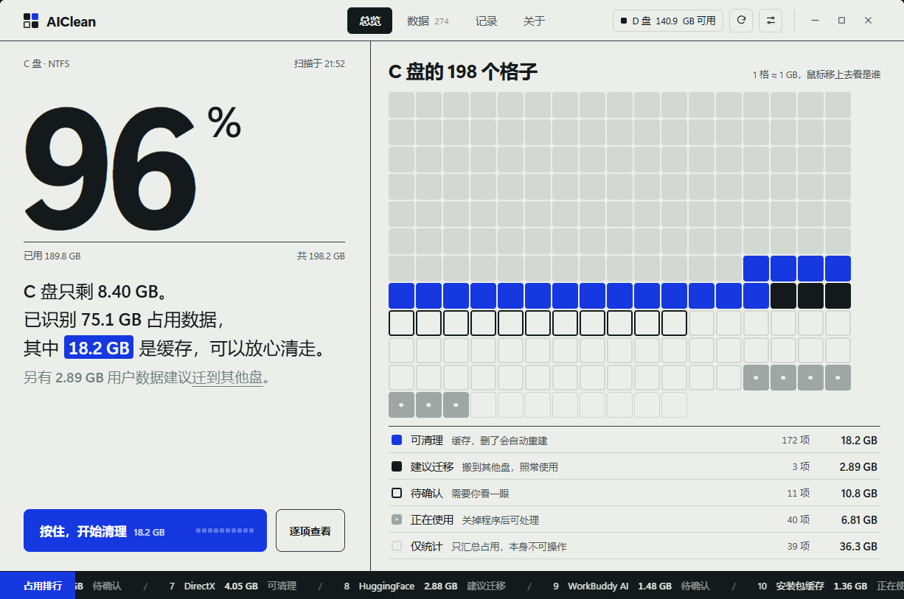
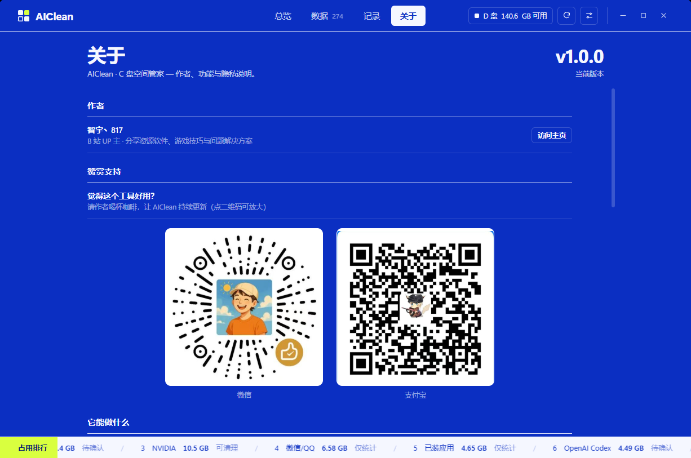

# AIClean · C 盘空间管家

AIClean 是一个 Windows 桌面工具，用来解决"C 盘空间反复爆满"的问题。它会扫描整盘占用、把可清理的缓存和系统残留找出来，也能把体积较大的用户数据迁移到其他盘。

单文件 exe，下载后直接运行，不需要安装。Windows 10/11 64 位。

**[下载最新版](https://github.com/ZYY817/aiclean/releases/latest)**



## 主要功能

### 磁盘占用总览

启动后自动扫描 C 盘，把整盘空间画成格子图（每格约 1 GB），按用途着色。哪些类别占了多少空间、各有多少项，一眼就能看到。识别不出的部分也会标注为"未识别"，不会漏报。

### 分类清理

扫描结果按处理建议分成五类，每一项都附说明文字，写清"这是什么、删掉会怎么样"：

- **可清理** —— 缓存类文件（着色器缓存、浏览器缓存、编译器缓存等），删除后软件会自行重建
- **建议迁移** —— 体积较大的用户数据（AI 模型、聊天记录、项目依赖等），不删除，建议搬到其他盘
- **待确认** —— 可能是垃圾但需要人工确认的内容，例如旧游戏存档、过期下载
- **正在使用** —— 文件正被运行的程序占用，需先关闭程序
- **仅统计** —— 只统计占用、不提供操作的系统或用户文件


除 200 多条内置规则外，还会自动发现规则库之外的 Electron 应用缓存和 ≥300MB 的大文件（含重复文件指纹比对）。

### 数据迁移

对于体积大但不想删的数据，AIClean 可以把它完整迁移到其他盘，然后在原位置创建 Junction 链接。对软件来说路径没有变化，可以正常读写，C 盘空间则被释放出来。

迁移前会自动在 C 盘留一份完整备份；确认软件运行正常后可以删除备份，也可以在任何时候一键迁回原位。

### 定时自动清理

可选功能。通过 Windows 计划任务定期自动清理低风险缓存，频率可设。默认关闭，开启时会先弹窗说明清理范围。

### 残留与日志

删除失败的文件会进入残留区，可以稍后重试或恢复，超过期限自动清除。每次操作（清理、迁移、迁回、删除备份）都会记录到操作日志，可随时查看。

### 卸载

设置页提供"彻底移除"：删除计划任务、开机自启项、数据目录和注册表残留。执行前会检查是否有未迁回的迁移数据或未清理的备份，由用户选择处理方式；选择保留的会生成一份桌面清单，注明数据位置。

## 安全机制

- 不可逆操作（直接删除、清空回收站、关闭休眠、删除迁移备份）需要按住按钮数秒确认
- 删除和迁移前会检查目标是否被进程占用，被占用的跳过
- 迁移采用"复制 → 校验 → 备份 → 建链接"的顺序，任一步失败都不会动原数据
- 删除迁移备份前会校验原位置链接指向和目标数据是否完整，通不过不删
- 首次启动弹出使用说明，列出所有不可恢复的操作
- 完全本地运行，不联网、不收集数据

## 使用说明

1. 下载 `AIClean.exe`，放到任意位置双击运行。
2. 等待扫描完成（首次约几十秒）。
3. 在总览页点"按住，开始清理"处理所有可清理项；或到数据页逐项处理。
4. 想迁移的数据在数据页选"搬到其他盘"，目标盘空间需大于数据本身。
5. 数据盘建议选常挂载的盘；U 盘拔走后迁移项会提示"盘未连接"。

可选：把 `rules.json` 放到 exe 同级目录，自定义规则会优先生效。

## 常见问题

**清理后软件打不开或变慢？** 被标记为"可清理"的都是缓存文件，软件下次启动会自动重建，第一次启动可能稍慢。系统关键文件不在可清理范围内。

**迁移后原文件夹还在？** 原位置剩下的是一个链接（Junction），不占空间。真实数据在 `其他盘:\AIClean-Moved\` 下，这个目录不要手动删除。

**需要管理员权限吗？** 日常清理不需要。处理 Windows 更新缓存等系统目录时会提示提权。

## 作者

智宇丶817 · B 站 [space.bilibili.com/41173761](https://space.bilibili.com/41173761)，分享资源软件与问题解决方案。关于页有微信和支付宝赞赏码，觉得好用可以支持一下。



---

<details>
<summary>从源码构建</summary>

需要 Go 1.27+、`goversioninfo`、Node（前端测试用）。

```powershell
cd aiclean
powershell -ExecutionPolicy Bypass -File build.ps1   # 输出 release\AIClean.exe + rules.json
```

版本号唯一来源是 `aiclean/VERSION`。测试：`go test ./...`、`node web/test/logic.test.js`。
</details>
